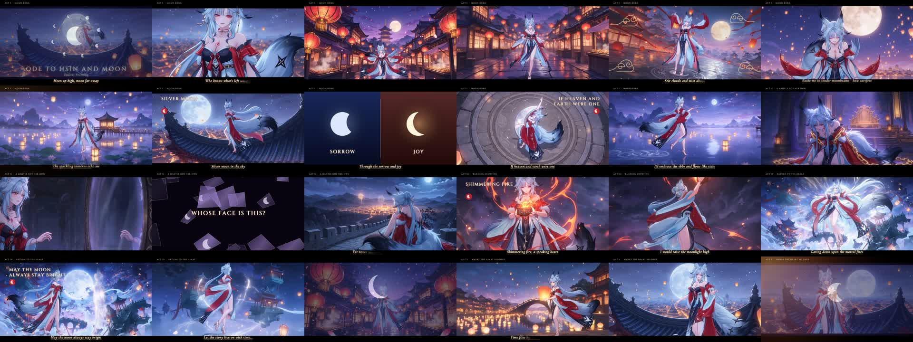
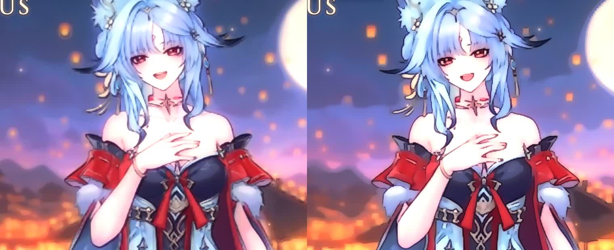
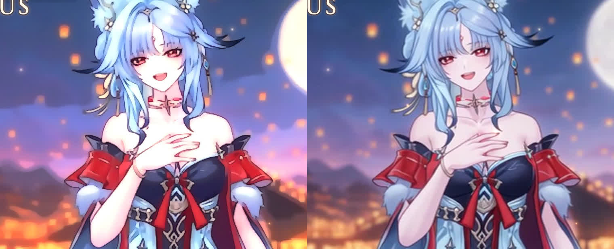
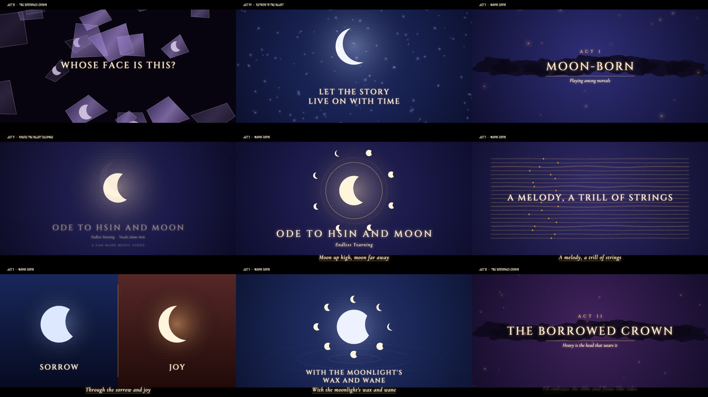

# Ode to Hsin and Moon: fan MV pipeline

A 3:36 2D-anime music video for *Ode to Hsin and Moon (Endless Yearning)*, starring the fox goddess 心月狐 (Hsin). It was made with Claude Code: generated character footage, plus a code-driven graphics layer locked to the song's beat.



## How it was made
| Stage | Tooling | Where |
|---|---|---|
| Choreography & camera study | Blender 5.2 base-mesh rig, beat-grid keyframing, IK feet, procedural tail | `blender/` |
| Story, storyboard, shot list | 5 acts, 48 shots, every cut on a beat (115.96 BPM) | `STORYBOARD.md`, `production/shots.py` |
| Scene design | Seedream 5.0 Pro empty background plates | `assets/plates/` |
| Character footage | Wan 3.0 reference-to-video at 480p, from the director's character sheet + plate + time-coded text choreography | `production/produce.py` |
| Graphics, lyrics, transitions | HTML/Canvas/WebGL compositor rendered frame-accurately by headless Chrome at 1080p | `studio/` |

All on-screen text is English typography rendered by code. The video model never draws text.

### Picture versions
Three finishes were rendered from the same edit:
1. **v1, code repaint** (`gl.js`): light repaint.
2. **v2, crisp code repaint** (`gl2.js`): bilateral flatten, shock-filter edges, FXAA and XDoG line art.
3. **v3, original footage**: Lanczos-scaled, no repaint.

| v1 → v2 | v2 → v3 |
|---|---|
|  |  |

### JS graphic panels


## Repository map
```
PROMPTS.md            director prompts (Part 1) + every generation prompt used (Part 2)
STORYBOARD.md         shot breakdown, beats, locations, choreography, camera
blender/              Blender rig, choreography engine, dance + camera (hsin_dance.py)
production/           shot list, choreography, Atlas driver with budget guard, review sheets, timeline builder, spend ledger
studio/               compositor: index.html, gl.js / gl2.js (repaint), fx.js (typography, panels, transitions), render.mjs
assets/plates/        Seedream scene plates (previews)
docs/images/          comparisons and overviews
skill/                the workflow packaged as a Claude skill (zip attached to the release)
```

## Reproduce
1. Put the song at `song.mp3`, or set `HSIN_SONG`. Create `production/lyrics.json` from `lyrics.example.json` using the song's LRC; it isn't committed.
2. Install and log in to the `atlas` CLI (Atlas Cloud), plus ffmpeg, Node 18+ and Chrome.
3. Generate:
   ```bash
   cd production
   python3 produce.py plates
   python3 produce.py clips --take 1 --workers 8
   ./review.sh S02_t1 S03_t1
   ```
   Pick takes in `picks.json`.
4. Build and render:
   ```bash
   python3 build_project.py
   cd ../studio && npm i && node server.mjs &
   node render.mjs --project=full --range=0:216.6 --fps=30
   ```
   Then mux the frames with the song using ffmpeg.

The full step-by-step, prompt rules and lessons are in the skill (`skill/anime-mv-pipeline/SKILL.md`).

## Budget
Atlas Cloud spend was **$19.26 of a $25 cap**, itemized in `production/spend_ledger.tsv`.

## Notes
- This is a fan work. The song, the character and the style reference belong to their owners. The repo does not include the song, the lyrics, the character sheet or the rendered videos.
- The Act II "crown that is not hers" is symbolic: power and duty that were never hers. It is shown as a moon seal, chains of light and a mantle, never as a physical crown.
